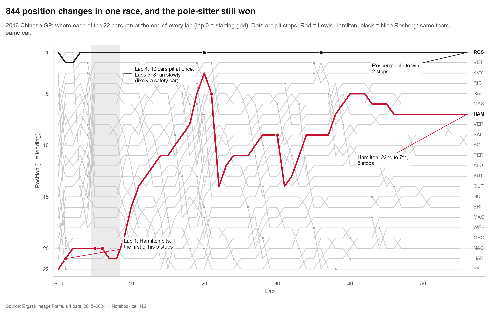
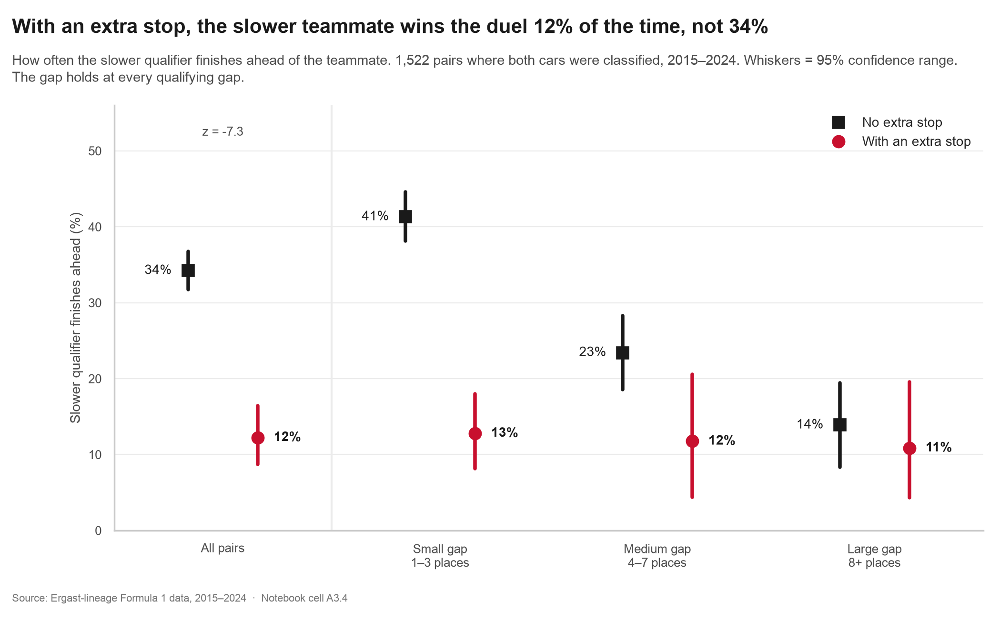
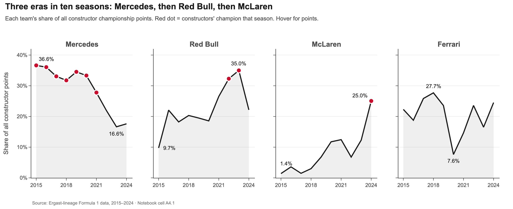

# Formula 1, read as a chain of cause and effect

**Ten seasons of Formula 1 data (2015–2024) turned into one story that explains how a race actually works:**
why Saturday's qualifying matters, when a pit stop helps or hurts, what an unplanned stop really means,
and how much of it is decided by the car.

[**Live interactive dashboard**](https://arwindhcn.github.io/f1-dashboard/) ·
[**Report (PDF)**](final_submission/F1_Report.pdf) ·
[**Slides (PDF)**](final_submission/F1_Presentation.pdf) ·
[**Analysis notebook**](final_submission/F1_Story_Notebook.ipynb) ·
[**Tableau story**](final_submission/tableau/F1_Dashboard.twbx)



## Why I built this
I didn't follow Formula 1 before this project. I picked it so I would have to learn the sport from its data:
how much the starting grid decides a race, when a pit stop helps or hurts, and what separates one driver from
another in the same car. Each act of the story answers a question I had as a newcomer, and the dashboard lets
anyone explore the same questions for any season, team, driver or circuit.

The result is built to teach F1 to someone who has never watched it: every chart first explains the idea
(grid, pit stop, undercut, DNF, points), then shows what the data says.

## What the data says
| Question | Finding |
|---|---|
| Does where you start decide where you finish? | Strongly: correlation **0.75**, grid explains about **56%** of the finishing order. The front row wins **77%** of races; at Monaco the link is **0.88**. |
| Does stopping early pay off (the undercut)? | Early stoppers drop **4.0** places, then win back **2.4**; late stoppers win back only **1.1** (3,490 pit stops). |
| Is an extra pit stop a gamble? | No. Qualifying far behind your teammate doesn't lead to extra stops (r = +0.02). An extra stop is an **alarm**: the slower teammate wins **12%** of duels with one vs **34%** without (z = -7.3). |
| How much does the car matter? | Most of all. Three eras in ten seasons: Mercedes 36.6% of all points (2015) → 16.6% (2023); McLaren 1.4% → 25.0%. **67%** of wins went to that year's champion team. |
| Are cars more reliable? | Car failures fell **70%** (10.6% → 3.1% of starts) while crashes barely changed (5.8% → 5.4%). |
| Has strategy changed? | One-stop finishers went 16% (2016) → 64% (2018) → 39% (2024): strategy swings a lot from season to season. |

Every finding above is a correlation in historical records, not proof of cause, and the report says so.
I also kept a weak result in (lap-time consistency barely predicts points, r = -0.18) and a deliberately
**misleading chart** next to its honest version, to show how a cut axis turns a 2.1% gap into a bar
3.0× taller.

<p align="center">
  
  
</p>

## What's inside
| File | What it is |
|---|---|
| [`F1_Story_Notebook.ipynb`](final_submission/F1_Story_Notebook.ipynb) | The full analysis as a story: cleaning, every calculation, 17 charts. Each number is recorded with the cell that produced it. |
| [`F1_Dashboard.html`](final_submission/F1_Dashboard.html) | Interactive Plotly dashboard in one offline file: filters for season, team, driver and circuit; all charts linked. |
| [`tableau/F1_Dashboard.twbx`](final_submission/tableau/F1_Dashboard.twbx) | Tableau workbook: a 14-point story "How F1 works", 4 dashboards (F1 in 60 seconds, interactive dashboard with click-to-filter, deep dive, ethics) and 15 charts, with packaged extracts. Opens in the free Tableau Public. |
| [`F1_Report.pdf`](final_submission/F1_Report.pdf) | 17-page written report. |
| [`F1_Presentation.pdf`](final_submission/F1_Presentation.pdf) | 16-slide presentation. |
| [`verification_log.md`](final_submission/verification_log.md) | Every earlier exploratory finding recomputed from raw data, with matches and corrections. |

## How it's built
- **Data:** the Ergast-lineage F1 dataset, 14 linked tables, filtered to 2015–2024: 209 races,
  4,219 race results, 227,123 lap records, 7,544 pit stops. Joins use ID keys only;
  "+1 Lap" finishers are kept separate from genuine retirements; pit-lane starts are treated as missing grid.
- **Tools:** Python (pandas, SciPy), Matplotlib for hand-annotated story charts, Seaborn for statistical charts with
  confidence intervals, Plotly for the interactive dashboard, and Tableau for the guided story and cross-filtering dashboards.
- **Every number is traceable:** the notebook records each figure in `facts.json` with its cell; the report, slides,
  dashboards and Tableau captions are generated from that file, and `check_numbers.py` confirms nothing is typed by hand.
- **Reproducible:** `make_all.sh` rebuilds everything from the raw CSVs and runs the notebook twice from a fresh
  kernel to confirm the results are stable.

## Run it yourself
```bash
cd final_submission
python -m venv ../.venv && ../.venv/bin/pip install pandas numpy scipy matplotlib seaborn plotly kaleido nbformat nbconvert ipykernel python-docx python-pptx tableauhyperapi lxml pymupdf
./make_all.sh
```
Raw data is in `final_submission/data/raw/`. Plotly's image export needs a Chromium browser (Chrome or Brave).

---
Arwindh C N · Built as a Data Visualisation case study (23CSE353) at Amrita Vishwa Vidyapeetham, Coimbatore.
